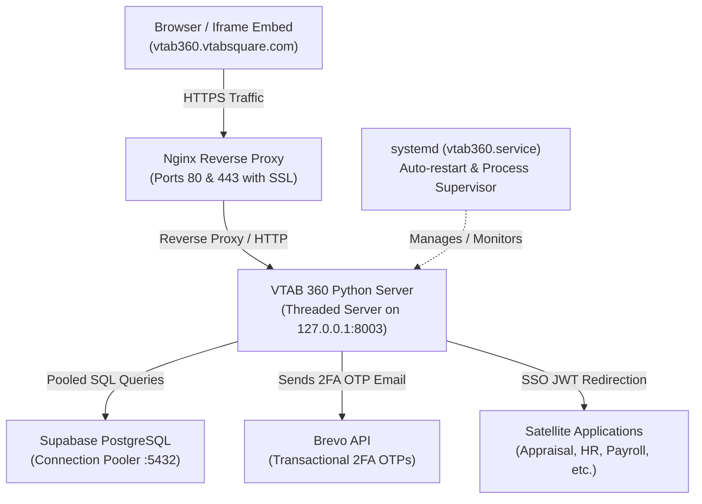
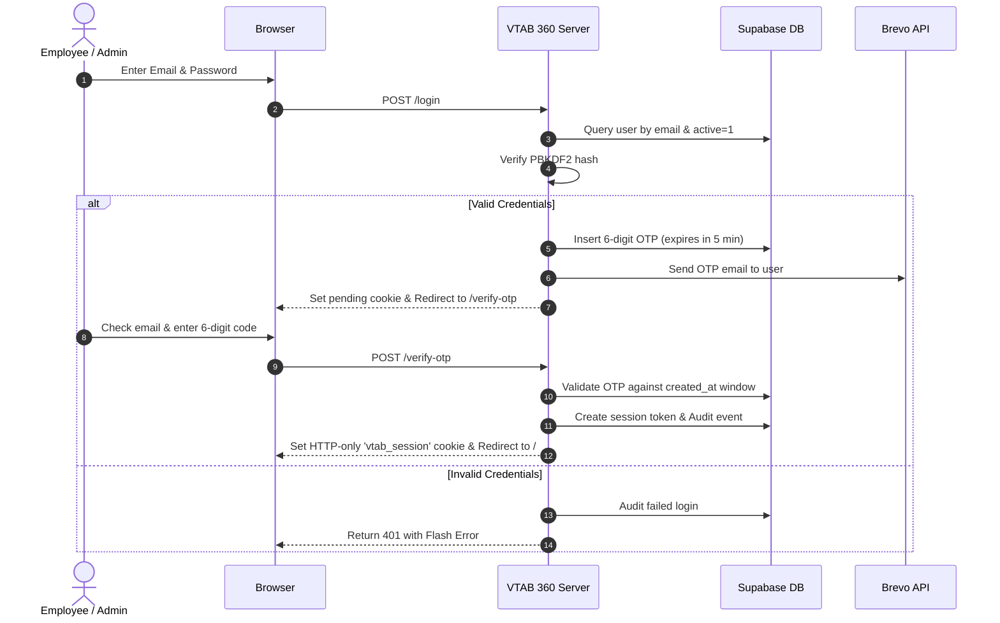
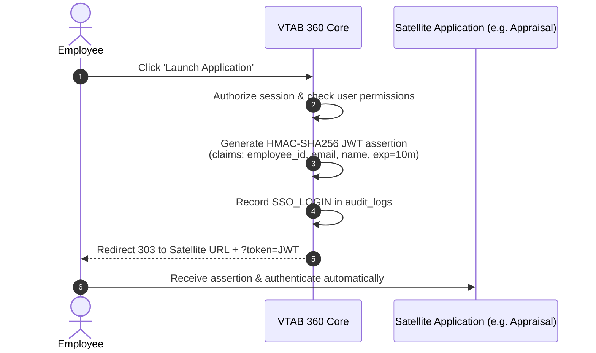

# VTAB Office Suite 365 (VTAB 360) — End-to-End Operational Runbook & System Architecture

**Document Version:** 1.0.0  
**Target Environment:** Production (`168.144.65.178` / `vtab360.vtabsquare.com`)  
**Prepared By:** Aakaash Padhmanaban  
**Classification:** Internal Engineering & Operations Guide  

---

## 1. Executive Summary & Purpose

**VTAB Office Suite 365 (VTAB 360)** is an enterprise unified workspace portal that acts as the central launchpad, single sign-on (SSO) gateway, and administrative control center for all VTAB Square enterprise applications (HR Portal, Payroll, Appraisal, Meet Assistant, etc.).

### Key Capabilities:
* **Central Identity Hub:** Authenticates corporate users using PBKDF2 password hashing paired with 2-Factor Authentication (OTP via Brevo).
* **Enterprise SSO Gateway:** Generates cryptographically signed JWT assertions to automatically log employees into satellite micro-apps without re-prompting for credentials.
* **Pilot / Demo Embeddable Mode:** Built-in restricted preview engine that allows the portal to be safely embedded as an `<iframe>` on `vtabsquare.com` with application launch interceptors and faded administrative settings.
* **Enterprise Governance & Audit Trail:** Full logging of administrative actions, user role changes, and application visibility policies.

---

## 2. System Architecture & Component Diagram

The application is engineered as a high-performance, lightweight architecture utilizing standard Linux and Python primitives:



### Component Breakdown:
* **Edge Proxy (Nginx):** Terminates TLS/SSL using Let's Encrypt certificates, manages HTTP-to-HTTPS redirection, and enforces Content Security Policies (`frame-ancestors`) to permit iframe embedding on `vtabsquare.com`.
* **Application Core (`app.py`):** Pure Python standard-library implementation using `ThreadingHTTPServer` and `BaseHTTPRequestHandler`. Zero heavy framework bloat (no Django/Flask runtime overhead).
* **Process Supervisor (systemd):** Runs the service as `vtab360.service` in the background, automatically restarting on process exit or droplet reboots.
* **Database (PostgreSQL via Supabase):** Relational store containing users, applications, announcements, audit logs, and payroll records. Connected through `psycopg2` via the IPv4 connection pooler.
* **Email Gateway (Brevo REST API):** Sends dynamic 6-digit one-time passcodes (OTP) for login verification and self-service password resets.

---

## 3. Core Workflows & Logic

### 3.1 Authentication & Two-Factor (2FA) Workflow
All standard users pass through a zero-trust two-step authentication sequence:



### 3.2 Single Sign-On (SSO) Launch Flow
When an employee launches a satellite application, VTAB 360 generates an assertion token:



### 3.3 Pilot / Demo Mode & Iframe Embed Engine
To enable prospect demonstrations and live embedding on the corporate website (`vtabsquare.com`):
* **One-Click Instant Access:** Visiting `https://vtab360.vtabsquare.com/demo` automatically creates a session as `VTAB Pilot User` (`role="Demo"`) with zero login prompts or OTP friction.
* **Faded & Locked Settings:** In the sidebar, App Settings and Admin links are faded (`opacity: 0.38`) with a `LOCKED` indicator.
* **Application Interceptor:** Clicking any application card prevents external navigation and opens the Pilot Modal offering a direct lead generation button: *"Contact for Full Access"*.
* **Permissive CSP Framing:** Configured with `Content-Security-Policy: frame-ancestors 'self' https://*.vtabsquare.com https://vtabsquare.com`.

---

## 4. Role-Based Access Control (RBAC) Matrix

| Feature / Endpoint | Administrator | Employee | Demo / Pilot User |
| :--- | :---: | :---: | :---: |
| **Workspace Dashboard (`/`)** | Full Access | Full Access | Pilot Preview Banner |
| **App Launcher (`/apps`)** | Full Access | Full Access | Intercepted with Demo Dialog |
| **Admin Applications (`/admin-apps`)** | Allowed | Forbidden (403) | Locked Preview Notice |
| **App Settings & User Governance (`/admin`)** | Allowed | Forbidden (403) | Faded & Locked |
| **Security Audit Trail** | Full View | Forbidden (403) | Locked |
| **Direct SSO Assertions (`/api/sso/token`)** | Allowed | Allowed | Blocked (Redirected) |

---

## 5. Environment Variables Reference

The service reads configuration values from `/opt/vtab360/.env`:

| Variable Name | Required | Default / Example Value | Description |
| :--- | :---: | :--- | :--- |
| `DATABASE_URL` | **Yes** | `<DATABASE_URL_FROM_SECRET_STORE>` | PostgreSQL connection pooler string. |
| `PORT` | **Yes** | `8003` | Local port bound by Python server. |
| `VTAB_HOST` | **Yes** | `127.0.0.1` | Local interface binding. |
| `VTAB_SECRET_KEY` | **Yes** | `<VTAB_SECRET_KEY_FROM_SECRET_STORE>` | Cryptographic secret for session cookie signatures (>= 32 bytes). |
| `VTAB_SSO_SECRET` | **Yes** | `<VTAB_SSO_SECRET_FROM_SECRET_STORE>` | Shared HMAC secret for satellite app SSO assertions. |
| `BREVO_API_KEY` | **Yes** | `xkeysib-...` | Brevo transactional email API key. |
| `AUTH_EMAIL_FROM` | No | `vitabsquare@gmail.com` | Verified sender email for OTP delivery. |
| `AUTH_EMAIL_NAME` | No | `VTAB365` | Friendly sender name for notification emails. |

---

## 6. Step-by-Step Server Setup & Deployment Runbook

### 6.1 Server Information
* **Host IP:** `168.144.65.178`
* **Operating System:** Ubuntu 24.04 LTS
* **Application Root:** `/opt/vtab360`
* **Python Runtime:** Python 3.12 (via `/opt/vtab360/.venv`)
* **Service Name:** `vtab360.service`
* **Internal Port:** `8003`
* **Public Domain:** `vtab360.vtabsquare.com`

### 6.2 Initial Directory & Code Placement
```bash
# 1. Create deployment directory
mkdir -p /opt/vtab360/public

# 2. Set up virtual environment
python3 -m venv /opt/vtab360/.venv
/opt/vtab360/.venv/bin/pip install --upgrade pip psycopg2-binary

# 3. Deploy application files
# app.py, style.css, app.js -> /opt/vtab360/
# logo.png -> /opt/vtab360/public/logo.png
```

### 6.3 Systemd Service Configuration
Create `/etc/systemd/system/vtab360.service`:
```ini
[Unit]
Description=VTAB 360 Office Suite Service
After=network.target

[Service]
Type=simple
User=root
WorkingDirectory=/opt/vtab360
EnvironmentFile=/opt/vtab360/.env
ExecStart=/opt/vtab360/.venv/bin/python app.py
Restart=always
RestartSec=3
KillSignal=SIGTERM
LimitNOFILE=65535

[Install]
WantedBy=multi-user.target
```

Enable and start the service:
```bash
systemctl daemon-reload
systemctl enable vtab360.service
systemctl restart vtab360.service
```

### 6.4 Nginx Reverse Proxy Configuration
Create `/etc/nginx/sites-available/vtab360.vtabsquare.com`:
```nginx
server {
    server_name vtab360.vtabsquare.com;
    client_max_body_size 20m;

    location / {
        proxy_pass http://127.0.0.1:8003;
        proxy_http_version 1.1;
        proxy_set_header Host $host;
        proxy_set_header X-Real-IP $remote_addr;
        proxy_set_header X-Forwarded-For $proxy_add_x_forwarded_for;
        proxy_set_header X-Forwarded-Proto $scheme;
        proxy_set_header Upgrade $http_upgrade;
        proxy_set_header Connection "upgrade";

        proxy_read_timeout 3600s;
        proxy_send_timeout 3600s;
        proxy_buffering off;
    }

    listen 80;
    listen [::]:80;
}
```

Enable the site and reload Nginx:
```bash
ln -sf /etc/nginx/sites-available/vtab360.vtabsquare.com /etc/nginx/sites-enabled/
nginx -t && systemctl reload nginx
```

### 6.5 SSL Certificate Installation (Certbot)
Once DNS points `vtab360.vtabsquare.com` to `168.144.65.178`:
```bash
certbot --nginx -d vtab360.vtabsquare.com --agree-tos -m vitabsquare@gmail.com --non-interactive
```

---

## 7. Operations & Maintenance Procedures

### 7.1 Service Management Commands
```bash
# Check service status
systemctl status vtab360.service

# Restart the application after code changes
systemctl restart vtab360.service

# Stop the application
systemctl stop vtab360.service

# View live application logs (tail -f)
journalctl -u vtab360.service -f -n 50
```

### 7.2 Database Maintenance & Restores
If database migration or disaster recovery is required:
* The consolidated schema & seed script is located at [`restore_supabase.sql`](file:///c:/Work/vtab-office-suite-python/vtab-office-suite-python/restore_supabase.sql).
* Can be executed directly via `psql` or the Supabase SQL Editor to restore all 11 tables and user records.

---

## 8. Troubleshooting Guide

| Symptom / Error | Root Cause | Resolution |
| :--- | :--- | :--- |
| **502 Bad Gateway in browser** | Python service is down or stopped. | Run `systemctl restart vtab360.service` and check `journalctl -u vtab360.service -n 25`. |
| **`FATAL: tenant not found`** | Supabase project is paused or pooler URL is incorrect. | Ensure `DATABASE_URL` in `/opt/vtab360/.env` uses the active pooler (`aws-0-eu-west-1.pooler.supabase.com`). |
| **OTP emails not arriving** | `BREVO_API_KEY` expired or unverified sender email. | Verify sender email in Brevo dashboard matches `AUTH_EMAIL_FROM`. Check server logs for `Failed to send OTP email`. |
| **Iframe refused to display** | CSP `frame-ancestors` header blocking host. | Check [`app.py#L377`](file:///c:/Work/vtab-office-suite-python/vtab-office-suite-python/app.py#L377) and verify the parent website domain is listed in `frame-ancestors`. |
| **Port 8003 collision** | Another process bound to port 8003. | Run `ss -tulpn \| grep 8003` to inspect PID. Update `PORT=8004` in `.env` and `proxy_pass` in Nginx if necessary. |
